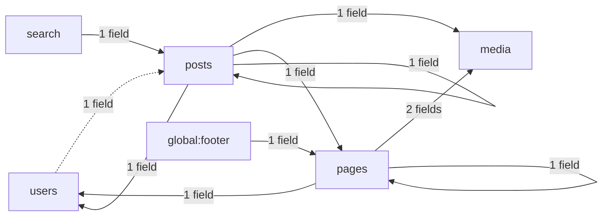

# payload-kort

See every relation in your Payload project in your terminal.

```sh
npx payload-kort
```

```
users
└─ posts (1 field, join)

pages
├─ media (2 fields)
├─ pages (1 field)
└─ users (1 field)

posts
├─ media (1 field)
├─ pages (1 field)
├─ posts (1 field)
└─ users (1 field)

search
└─ posts (1 field)

global:footer
└─ pages (1 field)

No outgoing relations: media
5 collections, 1 global, 10 relations
```

No database, no `.env`, no running server. Run one command in your project folder and get a map of how your collections point at each other.

## Why

Relations in a Payload config are spread over many files and hidden deep inside tabs, groups, arrays and blocks. In a real project a quick scan of the top-level fields finds only a fraction of them. `payload-kort` walks the whole field tree, so you see all of them.

It finds:

- `relationship` and `upload` fields, also with several targets (`relationTo: ['pages', 'posts']`)
- `join` fields (the reverse side of a relation)
- fields nested in tabs, groups, arrays and blocks
- shared blocks from `config.blocks` that are used through `blockReferences`
- relations from globals

Payload's own internal `payload-*` collections are left out.

## Usage

Run it from the root of your Payload project:

```sh
npx payload-kort
```

It looks for the config in this order:

1. `--config <path>`
2. the `PAYLOAD_CONFIG_PATH` environment variable
3. `src/payload.config.ts`
4. `payload.config.ts`

### Options

| Flag | What it does |
| --- | --- |
| `--config <path>` | Path to your Payload config |
| `--details` | Show which fields make up each relation |
| `--all` | Include collections added by plugins (redirects, forms, search and so on) |
| `--mermaid` | Print a [Mermaid](https://mermaid.js.org/) diagram instead of a tree |
| `--json` | Print the raw data as JSON |

### Details

Many fields often point at the same collection, so the tree groups them per target. Add `--details` to see the field paths:

```
pages
├─ media (2 fields)
│    layout<hero>.image
│    meta.image
├─ pages (1 field)
│    layout<link>.page
└─ users (1 field)
     author
```

`layout<hero>.image` means: the `image` field inside the `hero` block of the `layout` field.

### Plugin collections

Collections added by plugins are hidden as sources by default, so the map shows the model you wrote yourself. A field of yours that points at a plugin collection (for example a form block pointing at `forms`) is still shown. Use `--all` to include everything.

### Mermaid

```sh
npx payload-kort --mermaid > relations.mmd
```

GitHub renders Mermaid in Markdown, so you can paste the output into a ` ```mermaid ` block in your own README or docs:



Dotted arrows are `join` fields.

## How it works

`payload-kort` imports your config the same way your own code does, in a separate process, and reads the collections, globals and fields from it. It does not start Payload, connect to your database or need your environment variables.

> **Note:** importing your config runs your code. Any code at the top level of your config and its imports is executed, just like when you start your app. Only run `payload-kort` on projects you trust.

## Requirements

- A Payload 3 project. Tested on Payload 3.88.0 and 3.92.1.
- Node.js. Tested on Node 24.

## Development

```sh
npm install
npm test
npm run build
```

## License

[MIT](LICENSE)
