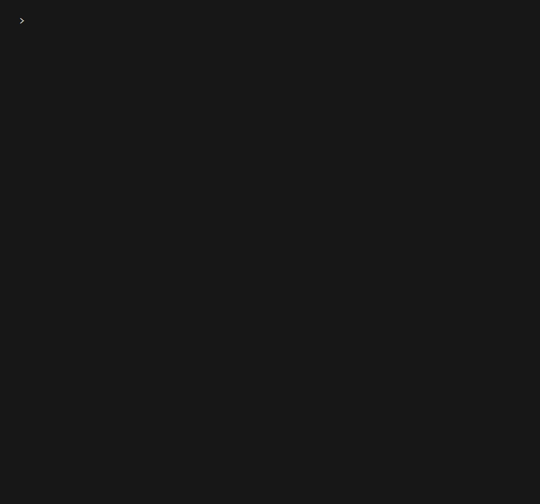
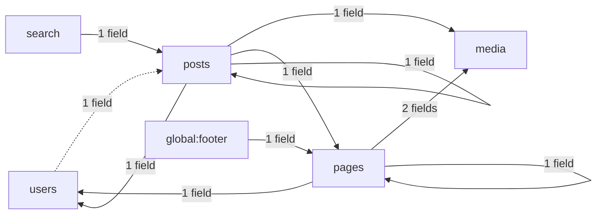

# payload-map

[](https://github.com/J0Money/payload-map/actions/workflows/ci.yml)

See every relation in your Payload project in your terminal.

```sh
npx payload-map
```



No database, no `.env`, no running server. Run one command in your project folder and get a map of how your collections point at each other.

## Why

Relations in a Payload config are spread over many files and hidden deep inside tabs, groups, arrays and blocks. In a real project a quick scan of the top-level fields finds only a fraction of them. `payload-map` walks the whole field tree, so you see all of them.

It finds:

- `relationship` and `upload` fields, also with several targets (`relationTo: ['pages', 'posts']`)
- `join` fields (the reverse side of a relation)
- fields nested in tabs, groups, arrays and blocks
- shared blocks from `config.blocks` that are used through `blockReferences`
- relations from globals
- relations inside `richText` fields (Lexical links, blocks, uploads and relationships)

Payload's own internal `payload-*` collections are left out.

## Usage

Run it from the root of your Payload project:

```sh
npx payload-map
```

It looks for the config in this order:

1. `--config <path>`
2. the `PAYLOAD_CONFIG_PATH` environment variable
3. `src/payload.config.ts`
4. `payload.config.ts`

### Options

| Flag | What it does |
| --- | --- |
| `--config <path>` | Path to your Payload config |
| `--details` | Show which fields make up each relation |
| `--to <collection>` | Show only what points at one collection |
| `--all` | Include collections added by plugins (redirects, forms, search and so on) |
| `--mermaid` | Print a [Mermaid](https://mermaid.js.org/) diagram instead of a tree |
| `--json` | Print the raw data as JSON |
| `--no-rich-text` | Leave out relations inside `richText` fields |
| `--rich-text` | Include relations inside `richText` fields in `--mermaid` (left out there by default) |

Colors are turned off when the output is piped to a file or another command, or when `NO_COLOR` is set.

### Details

Many fields often point at the same collection, so the tree groups them per target. Add `--details` to see the field paths:

```
pages
├─ media (2 fields)
│    layout<hero>.image
│    meta.image
├─ pages (1 field)
│    layout<link>.page
└─ users (1 field)
     author
```

`layout<hero>.image` means: the `image` field inside the `hero` block of the `layout` field.

### Unconnected collections

Below the tree, `payload-map` lists collections that point at nothing and that nothing points at:

```
Not connected to anything: newsletter
```

That can be fine (a log or a form inbox), but it can also be a collection nobody uses any more. Fields that may point at any collection (see [Rich text](#rich-text)) are not counted here, otherwise one such field would make every collection look connected.

### One collection

In a big project the full map can fill the screen. Name one or more collections to see only those (globals as `global:<slug>`):

```sh
npx payload-map pages
```

```
pages
├─ media (2 fields)
├─ pages (1 field)
└─ users (1 field)

1 collection, 0 globals, 4 relations
```

A collection you name is shown even when a plugin added it, without `--all`.

### Who points at a collection?

Before you rename or delete a collection, you want to know what depends on it. `--to` turns the map around:

```sh
npx payload-map --to media --details
```

```
media is pointed at by
├─ posts (4 fields, 3 rich text, 1 any collection)
│    details.cover
│    body{blocks}<mediaBlock>.media
│    body{upload}
│    body{relationship}
└─ pages (2 fields)
     layout<hero>.image
     meta.image

2 sources, 6 fields
```

Fields that may point at any collection are counted too, because they can point at this one. `--to` also works with `--json` and `--mermaid`, and together with a collection name: `npx payload-map pages --to media` shows only the fields in `pages` that point at `media`.

### Rich text

A Lexical `richText` field can hold links, blocks, uploads and relationships, and each of them can point at other collections. These relations are shown too, marked `rich text`:

```
posts
├─ media (3 fields, 2 rich text)
├─ pages (2 fields, 1 rich text)
├─ posts (2 fields, 1 rich text)
├─ any collection (1 field, rich text)
└─ users (1 field)
```

`any collection` means the editor feature has no limit, so it may point at every collection. In `--details` the editor feature is shown in braces, for example `content{blocks}<mediaBlock>.media` or `content{link}.doc`. Use `--no-rich-text` to hide these relations. In `--mermaid` they are hidden by default (see [Mermaid](#mermaid)).

### Plugin collections

Collections added by plugins are hidden as sources by default, so the map shows the model you wrote yourself. A field of yours that points at a plugin collection (for example a form block pointing at `forms`) is still shown. Use `--all` to include everything.

### Mermaid

```sh
npx payload-map --mermaid > relations.mmd
```

GitHub renders Mermaid in Markdown, so you can paste the output into a ` ```mermaid ` block in your own README or docs:



Dotted arrows are `join` fields.

Relations inside `richText` fields are left out of the diagram by default. One link field in the editor can point at almost every collection, and in a real project that easily adds dozens of arrows that only say "this field may link to anything". The diagram says how many it left out in a comment, which Mermaid does not draw:

```
%% 4 rich text fields left out. Add --rich-text to include them.
```

Add `--rich-text` to draw them anyway.

## How it works

`payload-map` imports your config the same way your own code does, in a separate process, and reads the collections, globals and fields from it. It does not start Payload, connect to your database or need your environment variables.

> **Note:** importing your config runs your code. Any code at the top level of your config and its imports is executed, just like when you start your app. Only run `payload-map` on projects you trust.

## Requirements

- A Payload 3 project. Tested on Payload 3.88.0, 3.92.1 and 3.94.0.
- Node.js 22 or newer. Tested on Node 22 and 24 on Linux, Windows and macOS.

## Development

```sh
npm install
npm test
npm run build
```

The GIF above is recorded with [VHS](https://github.com/charmbracelet/vhs) from a generic demo config in `demo/`. After a build, run `vhs demo/demo.tape` from the repo root to record it again.

## License

[MIT](LICENSE)
